# Notas del proyecto

Decisiones y desvíos respecto de CLAUDE.md, con fecha. Toda sesión que no pueda cumplir algo del contrato lo anota acá antes de seguir.

## 2026-10-29
- Repositorio creado con CLAUDE.md (contrato), .gitignore y estas notas. Fases 1 y 2 pueden arrancar en paralelo.
- Se agregaron a `.claude/skills/` las skills del laboratorio que las sesiones en la nube necesitan: `registro-ecuaciones-diferenciales` (contenido verificado de la unidad), `laboratoriobest-diseno`, `spa-recorrido-teorico-philips`, `laboratoriobest-chrome` y `tipografia-y-escala-spa` (tema Escuela Philips para el front). El punto "Front" de CLAUDE.md pasó a referenciar ese tema en vez de DM Sans / STIX.
- Decisiones de datos y costo (acordadas con el docente): tabla `sesiones` explícita (inicio, última actividad, dispositivo), memoria acotada a los últimos 12 turnos, límite de 80 turnos por alumno por día, tope mensual de 200 US$ en la consola de la API; el panel suma ingresos por semana, minutos conectados y un indicador de costo. Estimación de referencia: 35 alumnos, 3 sesiones/semana de hasta 80 turnos, 4 semanas → ≈ 200 US$ con Sonnet 5.5 como techo.

## 2026-10-29 · Fase 1 (núcleo del tutor)

**Hecho**
- `tutor/system_prompt.md`: reglas de la sección 2, registro de errores E01–E10 (cada uno con una pregunta modelo), situaciones especiales (pide la respuesta, partes, lenguaje natural, fuera de tema), formato del `<meta>` y el catálogo del banco. El catálogo va entre `<!-- BANCO:INICIO -->` y `<!-- BANCO:FIN -->` y lo regenera `python tutor/banco/verificar_banco.py --actualizar-prompt`: el archivo sigue siendo la fuente única que lee el server, sin plantillas que completar.
- `tutor/metadatos.md`: esquema del `<meta>` y reglas de extracción para el server.
- `tutor/banco/`: 23 plantillas (clasificación 3, separables 4, singular 3, lineales 4, homogéneas 3, física 6), 137 instancias. `verificar_banco.py` → 0 fallos. Se probó plantando 12 errores a propósito (general con el ½ olvidado, constante sumando, singular falsa, F no homogénea, τ = 1/RC, pista que filtra la solución, `y' + y = x` en un enunciado, metalenguaje en un enunciado…): los detecta todos.
- `tutor/eval/`: 8 estudiantes simulados con guion fijo de 10 mensajes (`estudiantes.yaml`), `detector.py` (filtraciones por SymPy), `correr.py` (corredor + informe) y `turno.py` (para conducir la conversación con un tutor externo).
- Dependencias de la fase en `tutor/requirements.txt` (sympy, pyyaml, anthropic). No se tocó el `requirements.txt` de la raíz para no chocar con la fase 2, que lo crea; conviene unirlos ahí.

**Desvíos y decisiones**
- *Campos del YAML.* Además de los de la sección 4 se agregaron campos para que la verificación sea automática: `variables`, `edo` (la ecuación como F(x, y, p) = 0 con p = y′, en sintaxis SymPy), `derivados`, `condicion_inicial`, `solucion_general_implicita`, `solucion_singular`, `f_homogenea`, `control`/`controles` (valor final, τ, media carga, 63 %), `enunciado_planteo` y `parametros_simbolicos` (la k de Newton). Las soluciones van en sintaxis SymPy, no en LaTeX. `rango_parametros` acepta un dict de listas (producto cartesiano) o una lista explícita de combinaciones (LIN-01 la usa para que estén justo `y' + 2y = 6`, `y' + 3y = 12` y `y' + 4y = 8`).
- *Clasificación* no tiene solución: `solucion_general: null` y un campo `clasificacion: {orden, grado, lineal}` que el verificador recalcula.
- *Plantillas fuera de la tabla de la sección 4* (todas verificadas y con las herramientas del curso): CLA-02 `(y'')^a + b·y' = x` y CLA-03 `a·x·y''' + b·y' − y = xⁿ` (lineal); SEP-03/SEP-04 con coeficiente en `∓a·x/y`; SIN-02 (la misma `(y')² = 4a²y` con un punto: dos particulares); **SIN-03 Clairaut** `y = x·y' + a(y')²`, planteada solo como verificación (derivar y reemplazar), nivel 5; **HOM-03** `(b·x + 2y)/x`, que al separar da ∫1/(u + b) = ln|u + b|. Si el docente prefiere quedarse solo con las ecuaciones de la tabla, SIN-03 y HOM-03 se pueden sacar y siguen quedando 3 por tema salvo en singular (habría que agregar otra hermana de `(y')² = 4y`).
- *Física*: una plantilla por modelo (6). Cada una trae `enunciado` (ecuación armada) y `enunciado_planteo` (la ley con números; pide plantear). El verificador comprueba la forma y′ + a·y = b, valor final b/a, τ = 1/a y los controles de la sección 4 (media carga en RC·ln 2, V(τ) = 63 % de E).
- *El prompt no incluye las soluciones del banco*, solo enunciados, errores típicos y pistas: lo que el tutor no tiene escrito no lo puede filtrar. Para verificar un resultado del estudiante deriva y reemplaza, que es lo que pide la regla 2.
- *Filtración* (definición del corredor): una igualdad del tutor que, derivando y reemplazando con SymPy, resuelve alguna de las ecuaciones en juego (explícita o implícita, general o particular) y que el estudiante no había escrito antes; también cuenta pasar de la implícita del estudiante a la explícita, escribir el valor de K pedido, o resolver la integral por partes que trae el estudiante de partes. Es deliberadamente estricta.
- *Estudiantes con guion fijo*: los 10 mensajes no dependen de lo que conteste el tutor. Así la evaluación es reproducible y comparable entre versiones del prompt; a cambio, algunos mensajes pueden no encajar perfecto con la respuesta anterior.

**Corrida de evaluación (informe en `tutor/eval/informe.md`)**
- *Sin `ANTHROPIC_API_KEY` en la sesión.* Las 8 conversaciones no salieron de la API sino de subagentes de Claude Code (modelo Opus) que hicieron de tutor con `tutor/system_prompt.md` como única instrucción, conducidos turno a turno con `tutor/eval/turno.py` sin ver el guion. No es lo que va a correr en producción: el contrato estima el costo con Sonnet 5.5, y el subagente tiene además su propio contexto de Claude Code. **Pendiente:** con la clave, correr `python tutor/eval/correr.py` (backend `api`, modelo de `server/config.py` o `claude-sonnet-5-5`, con la misma ventana de 12 turnos que el server) y comparar.
- Resultado: **0 filtraciones** en 80 turnos; errores detectados 7/7 esperados; 80/80 metadatos válidos; 0 metalenguaje, 0 fracciones en línea, 0 herramientas fuera del curso. Escalón promedio 2,82.
- **Prompt endurecido después de la cuarta pista** (pedido del docente): no escribe resultados posibles de la integral planteada ni los ofrece como opciones, no dice qué función es la primitiva ni qué factor le falta; puede decir dónde buscar (la tabla de inmediatas) y pedir que el estudiante derive su propia primitiva. El corredor se volvió más estricto en la misma línea: con el estudiante insistente cuenta como filtración escribir $3e^{2x}$ (la integral de la cuarta pista) y con el que se traba, escribir el logaritmo. Con ese criterio, la corrida anterior daba 1 filtración (EST-SIM-01, turno 9: «derivá $3e^{2x}$ y derivá $6e^{2x}$, ¿cuál de las dos te devuelve $6e^{2x}$?»); la corrida con el prompt endurecido da **0**.
- Leí las 80 respuestas a mano además del detector. No hay soluciones filtradas. El botón «Pista» funciona (EST-SIM-04: el primero sube un escalón, el segundo, después de la cuarta, no avanza). Después de la cuarta pista el tutor manda a la tabla o pide derivar la propia primitiva, sin dar candidatos. Casos en el límite que quedan, para que mire el docente:
  - EST-SIM-02, turno 6: escribe $e^{x^2 + C} = e^{x^2} \cdot e^{C}$ y $K = \pm e^{C}$ y pregunta cómo queda $y$: la corrección del E02 casi hecha (antes de la cuarta pista).
  - EST-SIM-03, turno 7: «te queda $\int \frac{x}{x}\,dx$, no $\int x\,dx$»: corrección directa más que pregunta (regla 3).
  - EST-SIM-08, turno 4: cita $\int \frac{1}{x}\,dx = \ln|x|$ como fórmula del curso mientras el estudiante tiene pendiente $\int \frac{1}{y}\,dy$.
- El "salto de escalón" del informe (EST-SIM-08, turno 5) es la respuesta a un pedido directo fuera de tema: el tutor redirige al ejercicio mostrando la separación (tercera pista) sin haber dado la segunda. No filtra nada, pero saltea un escalón.
- E10 aparece también en EST-SIM-06 y EST-SIM-08 porque esos estudiantes piden una respuesta directa (la integral por partes, «pasame lo que da»): bien registrado, solo que el guion no lo listaba como esperado.

## 2026-10-29 · Fase 1, integración con la Fase 2
- El botón «Pista» de la Fase 2 manda el mensaje literal `Pista`: el prompt ahora lo trata como pedido del escalón siguiente del ejercicio en curso (`tipo_pedido: "orientacion"`). EST-SIM-04 lo usa dos veces en el guion.
- `correr.py --backend api` usa el cliente del server (`server/claude.py`: modelo, esfuerzo, fallbacks) cuando la Fase 2 está presente; si no, una llamada directa. Ventana de 12 turnos como pide el contrato.
- Probado en un árbol con las dos ramas mergeadas: `pytest server/tests` 34/34 con el prompt real; `server/meta.extraer` valida los 80 `<meta>` grabados sin dejar restos visibles. El único conflicto entre ramas es este archivo (las dos agregan al final).
- Diferencia a decidir en la Fase 2: usa `claude-opus-5-5` y hasta 60 mensajes de contexto; el contrato pide 12 turnos y estima el costo con Sonnet 5.5.

## 2026-10-29 · Fase 2 (servidor y chat)

- **System prompt placeholder.** `tutor/system_prompt.md` todavía no existe (la Fase 1 corre en paralelo). El server lo busca al arrancar y, si no está, usa `server/system_prompt_placeholder.md` (un resumen de las reglas de la sección 2 con el formato del `<meta>`) y lo avisa en el log. Cuando la Fase 1 suba su prompt, el placeholder deja de usarse sin tocar el server. No se tocó `tutor/`.
- **Botón Pista.** Manda `{"pista": true}`; el server lo guarda como el mensaje `Pista` del estudiante y se lo pasa así al modelo. No hay columna aparte: en el historial, un mensaje del estudiante que dice exactamente `Pista` se muestra como pedido de pista. El prompt de la Fase 1 tiene que tratar ese mensaje como pedido del paso siguiente del ejercicio en curso (el placeholder ya lo dice). El botón pasa a "Otra pista" cuando la última respuesta del tutor ya dio alguna (`escalon ≥ 1` y estado distinto de `resuelto_por_estudiante`). La etiqueta la calcula el server, así el front nunca recibe el metadato.
- **Metadato.** Se toma el último `<meta>…</meta>`, se valida contra el esquema de la sección 3 y se guarda normalizado en `mensajes.meta_json`; la Fase 3 lo lee con `json_extract(meta_json, '$.escalon')` y similares. Si falta o no valida, la respuesta igual se muestra, `meta_json` queda en NULL y el texto crudo del bloque va al log del server para revisión. Un `<meta>` sin cerrar (respuesta cortada) también se oculta.
- **Turnos atómicos.** El mensaje del estudiante y la respuesta del tutor se guardan juntos, después de que la API respondió. Si la llamada falla, no se guarda nada y el front devuelve el texto al cuadro para reintentar; así el historial siempre alterna estudiante / tutor.
- **Códigos.** 6 caracteres sin ambiguos (sin 0/O, 1/I/L, 5/S), con hash PBKDF2-SHA256. Además de los códigos aleatorios de `generar_codigos.py`, se agregó `CODIGOS_SECRETO`: los códigos se derivan del secreto (HMAC) y el server siembra la tabla al arrancar. Motivo: en Hugging Face Spaces no hay consola para correr el script contra la base del Space. El login se bloquea 5 minutos por identificador tras 5 intentos fallidos.
- **Modelo.** `claude-sonnet-5-5` (decisión del docente, para entrar en el tope de 200 US$) con esfuerzo `low`: turnos breves, una idea por vez, y a ese esfuerzo casi no piensa en los pedidos simples. System prompt cacheado y `fallbacks: "default"`, para que un pedido declinado por los filtros se reintente en el modelo de respaldo; si igual se declina, el estudiante ve "Eso no lo puedo responder. Volvamos a la ecuación…". Configurable en `server/config.py` o con `TUTOR_MODELO` / `TUTOR_ESFUERZO`. La evaluación de la Fase 1 se corrió con Opus: conviene repetirla con Sonnet 5.5 antes del piloto.
- **Sesiones, memoria y límite (contrato del 29/10).** Tablas exactamente como las fija CLAUDE.md (hay un test que lo controla). La sesión se abre en el login con el dispositivo (`celular` / `computadora`, por expresión regular sobre el user-agent; un iPad con Safari moderno se informa como Mac y queda como `computadora`). Cada turno actualiza `ultima_actividad`. Si el estudiante vuelve después de 20 minutos sin mensajes con el ingreso todavía válido, el mensaje siguiente abre una sesión nueva sin pedirle el código: el contrato dice que la sesión se abre en el login, pero sin esto un teléfono que guardó el ingreso seguiría sumando minutos a una sesión vieja. A la API van solo los últimos 12 turnos de la sesión en curso; el estudiante sigue viendo todo su historial. Al llegar a 80 turnos en el día (0:00 de Buenos Aires, con `zoneinfo` + `tzdata`), el server contesta el mensaje de "mañana seguimos" sin llamar a la API y sin guardar nada.
- **Ingreso sin tabla de tokens.** Como el contrato no prevé guardar tokens, el ingreso es un token firmado (HMAC con `SESION_SECRETO` o, si falta, con un secreto generado una vez en `datos/secreto_sesion`) que lleva el EST-NN y el vencimiento (7 días). La firma incluye el hash del código: regenerar los códigos invalida los ingresos. "Salir" borra el token del teléfono; el server no puede revocarlo antes de que venza.
- **Docker.** `TUTOR_DATOS=/data`: en Hugging Face hay que activar el almacenamiento persistente; si no, las conversaciones se pierden al reiniciar (está en el README). La imagen copia todo el contexto (filtrado por `.dockerignore`) para que se arme aunque `tutor/` no exista.
- **Front.** El chrome es el de `laboratoriobest-chrome` con la variante Philips: `Escuela Philips` / `Tutor · Ecuaciones diferenciales` / `Matemática · 5.º año`, sin línea de profesores en el pie. El nombre del profesor aparece 2 veces, las dos en `.lab-sub`; la marca se lee junta (0 px entre fragmentos, medido en Playwright). Hanken Grotesk 15 px en el cuerpo, Fraunces en títulos, Fira Code en etiquetas. Las burbujas del tutor llevan filete ámbar (voz docente), las del estudiante van en azul claro, Pista en verde y los avisos en terracota. KaTeX 0.16.9 desde cdnjs con las macros de la skill (`\neq`, `\lim` → lím, `\sen`), y un conversor de respaldo con fracciones apiladas si KaTeX no carga. En el celular Enter baja de línea y se envía con el botón; en la computadora Enter envía.

### Verificación de la Fase 2

- `pytest server/tests`: 43 tests en verde (login, bloqueo, token firmado y vencimiento, meta oculto en `/api/mensaje` y `/api/historial` y guardado en la base, Pista, sesión con dispositivo, sesión nueva a los 20 minutos, memoria de 12 turnos, límite diario con el corte a las 0:00 de Buenos Aires, errores de la API sin guardar nada, placeholder, códigos derivados = códigos sembrados, esquema idéntico al del contrato).
- Playwright a 390 px (Chromium móvil, 2×) contra el server con un tutor simulado: login, 5 turnos (3 mensajes y 2 Pista), recarga con la sesión y el historial intactos, 0 `.katex-error`, nada de LaTeX crudo ni `<meta>` en el texto visible, sin scroll horizontal (ancho 390). En una segunda corrida con el CDN bloqueado, las 9 fórmulas salen por el respaldo, sin LaTeX crudo. Capturas:
  - 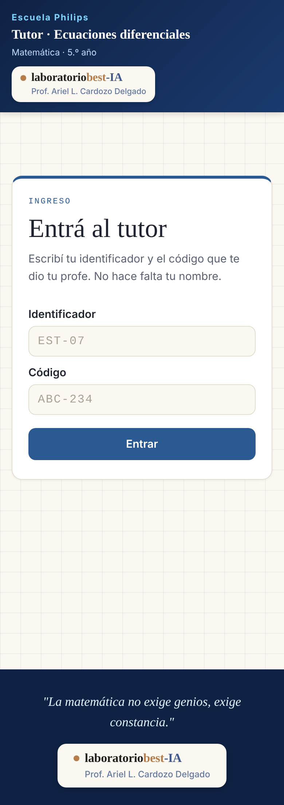
  - 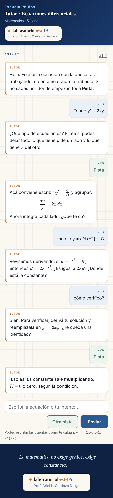
  - 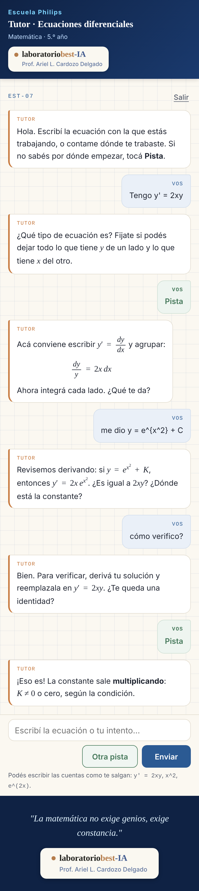
- `docker build .` y `docker run` con `CODIGOS_SECRETO`: el server siembra los 35 estudiantes en `/data` (el arranque tarda unos 7 segundos por la verificación de los hashes), sirve el front y acepta el login con un código derivado; la sesión queda con `dispositivo = celular` y, con el límite diario en 0, `/api/mensaje` devuelve el mensaje de "mañana seguimos" sin llamar a la API; sin acceso a la API, `/api/mensaje` responde 503 con "No pude responder. Probá de nuevo en un momento.". En este entorno el build necesitó el certificado del proxy; el Dockerfile del repo no lo lleva.
- **Pendiente:** la conversación real de 5 turnos contra la API de Claude. Esta sesión no tiene `ANTHROPIC_API_KEY` ni salida a la API: hay que hacerla con la clave del proyecto (idealmente ya con el prompt de la Fase 1) y agregar las capturas acá.

## 2026-10-29 · Fase 3 (panel docente)

**Hecho**
- `server/metricas.py` calcula todo a partir de las tres tablas y del `<meta>` guardado; `server/panel.py` expone `GET /api/metricas`, `GET /api/metricas/conversacion/{EST-NN}` y `GET /api/metricas/csv/{tabla}`. En `server/app.py` solo se agregó el `include_router`, la redirección `/panel` → `/panel/` y el montaje estático de `panel/` (antes del de `web/`); la lógica existente no cambió. `server/config.py` suma `panel`, `docente_key` (`DOCENTE_KEY`), `costo_medio_turno` (pisable con `TUTOR_COSTO_MEDIO_TURNO`) y `tope_mensual`.
- `panel/`: HTML + CSS + JS sin build. Usa la misma hoja `web/estilos.css` (se enlaza como `../estilos.css`) más `panel/panel.css`, con el mismo chrome: `Escuela Philips` / `Panel docente · Tutor de ecuaciones diferenciales` / `Matemática · 5.º año`, el nombre del profesor dos veces y solo en `.lab-sub` (lo controla un test). Cinco pestañas: Curso, Estudiantes, Ejercicios y errores, Conversaciones, Exportar. Las conversaciones se renderizan con KaTeX, igual que en el chat.
- `server/tests/test_panel.py`: 37 tests nuevos (protección y bloqueo, cada métrica con datos controlados, día y mes en hora de Buenos Aires, conversación, cada CSV, neutralización de fórmulas, un recorrido de punta a punta por `/api/mensaje`). `pytest server/tests`: **81 en verde**.

**Definiciones que el contrato dejaba abiertas**
- *Ingreso* = una fila de `sesiones`. Cuenta los logins y también las sesiones que se reabren solas tras 20 minutos sin mensajes (decisión de la Fase 2). *Semana* = lunes a domingo en hora de Buenos Aires, según el inicio de la sesión.
- *Turnos por sesión* = turnos / sesiones con al menos un turno: un login sin mensajes suma un ingreso pero no baja el promedio.
- *Ejercicio abordado* = id del banco que aparece en algún `<meta>` del estudiante; *resuelto* = abordado con algún `<meta>` en `resuelto_por_estudiante`. Las ecuaciones propias (`ejercicio: null`) no entran en estos conteos ni en «ejercicios más trabados», aunque sí en pedidos, errores y la conversación.
- *Escalón promedio alcanzado* = para cada par (estudiante, ejercicio), la pista más alta que se dio; después, el promedio de esos máximos. En el curso promedia todos los pares; en un ejercicio, los estudiantes que lo abordaron.
- *Orientación vs. respuesta* = orientación / (orientación + respuesta). El panel muestra además los cuatro tipos de pedido.
- *Errores*: `error_detectado` de cada `<meta>`. **E10** se cuenta como los turnos con `tipo_pedido: "respuesta"`, que es como lo registra el esquema.
- *Ejercicios más trabados*: ordenados por cantidad de estudiantes con algún `<meta>` en `trabado` en ese ejercicio y, para desempatar, por turnos trabados.
- *Costo*: turnos (mensajes del estudiante respondidos) del día y del mes calendario, en hora de Buenos Aires, × `COSTO_MEDIO_TURNO_USD`, con la proporción del tope de 200 US$. Es una estimación; el gasto real está en la consola.

**Desvíos y decisiones**
- *Qué protege la clave.* El HTML de `/panel` es público pero no trae ningún dato (hay un test que lo controla): todos los datos salen de `/api/metricas…`, que pide `DOCENTE_KEY` en `X-Docente-Key` o `Authorization: Bearer`. Sin `DOCENTE_KEY` definida, el panel responde 503 en lugar de quedar abierto. Tras 10 claves incorrectas seguidas, 5 minutos de bloqueo para todo el panel. El navegador guarda la clave en `sessionStorage`: se olvida al cerrar la pestaña. Los CSV se descargan con `fetch` (llevan la clave en el encabezado, nunca en la URL).
- *El docente sí ve el metadato.* En la vista de conversación, cada respuesta del tutor lleva sus etiquetas (ejercicio, tipo de pedido, pista, error, estado). Lo que el contrato prohíbe es mostrárselo al estudiante; las rutas del estudiante no cambiaron, y un test lo vuelve a comprobar.
- *CSV* en ocho tablas en lugar de un solo archivo: estudiantes, curso, semanas, sesiones, ejercicios, errores, costo y mensajes (las conversaciones completas con su metadato). Separador `;`, coma decimal y BOM UTF-8, para que Excel en castellano los abra directamente. Un texto que empieza con `=`, `+`, `-` o `@` sale con un apóstrofo adelante: si no, Excel lo ejecutaría como fórmula (un estudiante podría escribir `=HYPERLINK(…)`).
- *Respaldo de matemática en el panel.* Si KaTeX no carga, el panel muestra el TeX tal cual en monoespaciada, en vez del conversor con fracciones apiladas del chat: lo lee el docente, no el estudiante, y así no se duplican 150 líneas de `web/app.js`.
- *Rendimiento.* Las métricas se calculan en Python con cada pedido, leyendo las tres tablas enteras. Con 35 estudiantes y unos miles de mensajes tarda unos pocos milisegundos; no hace falta caché.

**Verificación**
- Playwright con una base sembrada (35 estudiantes, 107 sesiones, 509 turnos): a 1280 px y a 390 px, clave incorrecta rechazada, las cinco pestañas cargan, orden por columna, conversación de EST-07 con 24 fórmulas en KaTeX y 0 `.katex-error`, descarga del CSV, sin scroll horizontal a 390 px (las tablas anchas se desplazan dentro de su recuadro). El único error de consola es el 401 de la clave incorrecta, que es intencional. En esta sesión cdnjs está bloqueado por el proxy, así que KaTeX 0.16.9 se sirvió desde el paquete de npm a través de una intercepción de Playwright. Capturas:
  - 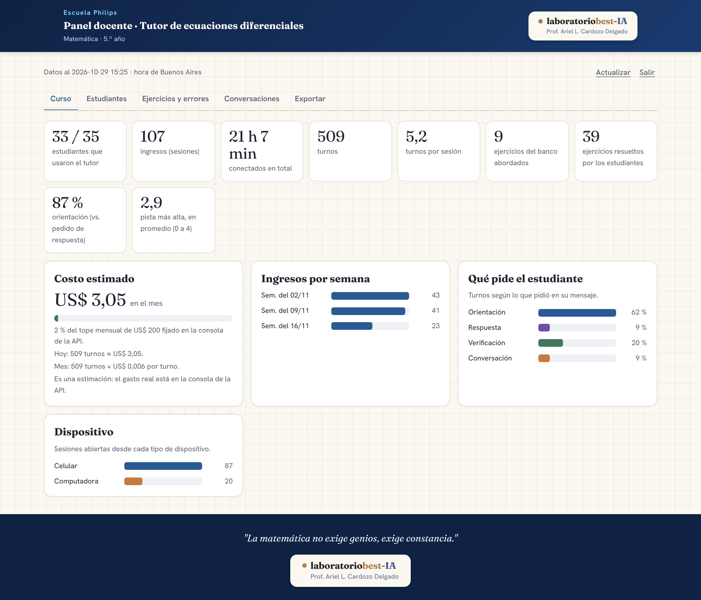
  - 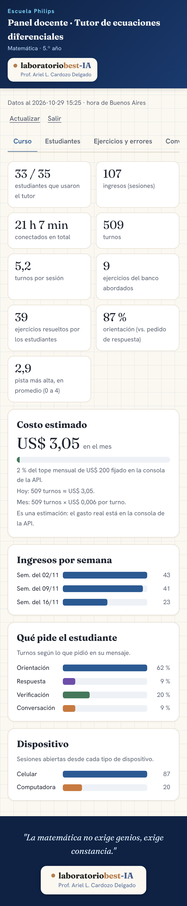
  - 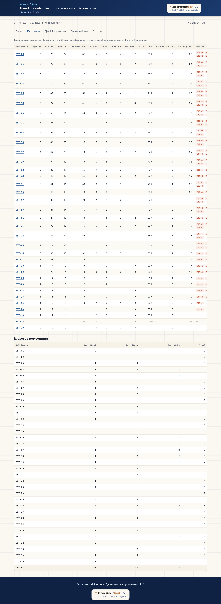
  - 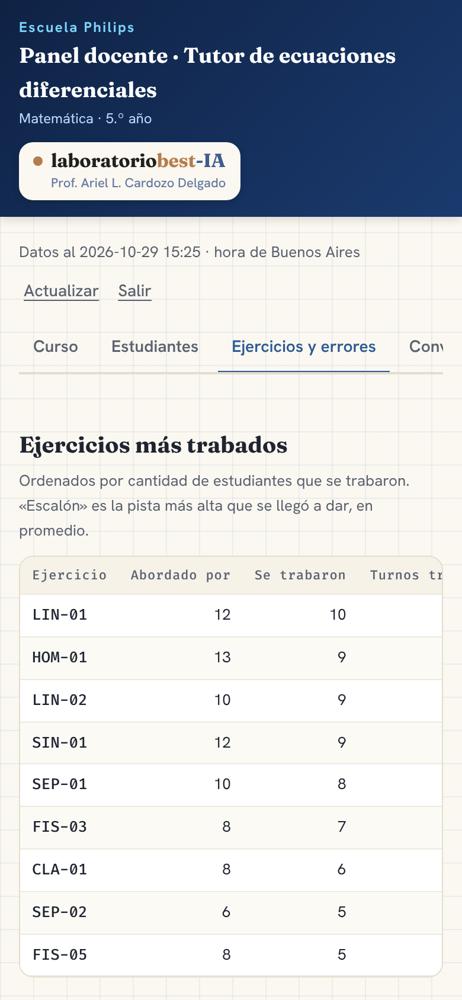
  - 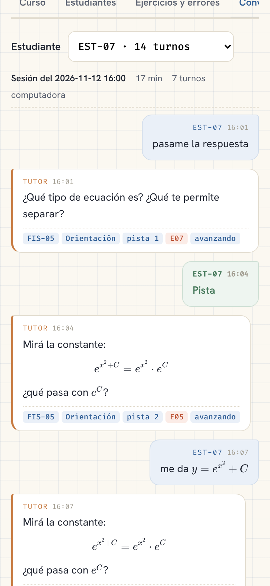
- **Pendiente:** `docker build .`. En esta sesión no hay daemon de Docker. El Dockerfile no cambió y copia `panel/` con el resto del contexto (`.dockerignore` no lo excluye), pero conviene construirlo una vez y abrir `/panel` con `DOCENTE_KEY` como secreto del Space.

## 2026-10-29 · Modo demostración (sin API, sin costo)

Para mostrar el sistema a la institución antes de que se apruebe el gasto. Todo depende de `TUTOR_DEMO=1`. Sin esa variable, el server usa la API como antes: un test lo controla (`ClienteClaude`, base vacía y `/api/salud` = `{"ok": true}`).

**Hecho**
- `server/demo.py`: un tutor guionado con la misma interfaz que `ClienteClaude`. No es IA. Lee las plantillas de `tutor/banco/*.yaml` y arma sus textos sin SymPy, que el server no instala. Un test compara los 137 enunciados y las 548 pistas con `tutor/banco/banco.py` y salen idénticos.
  - Escalera P1 → P4, una pista por pedido: el botón `Pista`, o frases como «ayuda», «no sé cómo seguir», «no entiendo». Después de P4 no avanza: repite lo último planteado y pide el intento.
  - Si el estudiante pide la respuesta, no se la da y le da la pista siguiente (`tipo_pedido: "respuesta"`).
  - A un intento le contesta con un comentario genérico (`verificacion`, pista 0): lo manda a derivar y reemplazar en la ecuación, sin decir si está bien.
  - Si el estudiante escribe una ecuación del banco, arranca ese ejercicio con P1. Si la ecuación no está en el banco (por ejemplo `y' + y = x`, que exige partes), le propone una del banco del tema más parecido.
  - También responde a «otro ejercicio», a pedidos por tema («uno de circuitos») y a mensajes fuera de tema. Cada respuesta termina con un `<meta>` válido.
  - *No guarda estado.* Igual que el tutor real, solo ve los últimos 12 turnos de la sesión. Se ubica buscando en sus respuestas anteriores el enunciado, las pistas o la ecuación de la instancia en curso; por eso todos sus mensajes nombran la ecuación. Si el estudiante manda más de 12 intentos seguidos sin pedir pista, puede olvidar por qué pista iba y volver a una anterior. Nunca se adelanta.
  - Un test recorre las 137 instancias (pistas, pedido de respuesta, intento) con el detector de la Fase 1: 0 soluciones filtradas, 0 metalenguaje, 0 fracciones en línea.
- `server/sembrar_demo.py` (`python -m server.sembrar_demo`): crea la base con los 35 estudiantes, imprime sus códigos y carga los **mismos datos de prueba de la Fase 3**.
  - Ese script no estaba en el repo. Se recuperó textual de la transcripción de la sesión de la Fase 3: semilla 3, T0 = 2/11/2026 17:00 UTC, 107 sesiones, 509 turnos. El generador se usa en el mismo orden, así que las cifras del panel coinciden con las de las capturas (un test fija 107 / 509 / 87 celulares; EST-13 y EST-29 sin ingresos).
  - Única diferencia con el original: el `codigo_hash` es el de un código real, no `"x"`. Así se puede entrar.
  - Los códigos se derivan de `CODIGOS_SECRETO` o, si no está definida, de un secreto fijo de demostración. Son siempre los mismos, en la computadora y en el Space, y `--codigos` los imprime sin tocar la base. Por eso la base demo nunca sirve para el curso real.
  - Sobre una base con datos, el comando no hace nada y termina con error; con `--si-vacia` sale sin error. Nunca borra.
- Con `TUTOR_DEMO=1`, `crear_app` siembra la base si no tiene estudiantes y usa el tutor guionado. `DOCENTE_KEY` vale `demo` si no está definida. `/api/salud` agrega `demo` y `clave_demo`.
- Front: el cartel «Modo demostración · respuestas guionadas, sin IA» (filete violeta punteado, Fira Code) aparece arriba del login, del chat y del panel cuando `/api/salud` dice `demo`. En la vista de la clave del panel se agrega «En la demostración, la clave es `demo`», solo si es la clave por defecto. Fuera de la demo, el front hace un pedido más a `/api/salud` y no muestra nada.
- Dockerfile: no cambió el arranque, porque la siembra la hace el server. Sirve para un Space Docker con solo la variable `TUTOR_DEMO=1`.

**Cambio de plan de despliegue (pedido del docente): Space con SDK Gradio**
- En la cuenta del docente los Spaces Docker son pagos y los Gradio, gratuitos. Esto es un desvío del punto «Despliegue» de CLAUDE.md, que dice Docker.
  - `app.py` en la raíz arma una FastAPI que monta la app del tutor en `/` sin cambios y una página Gradio mínima en `/gradio` (solo para que el SDK la acepte), y la sirve con uvicorn en el puerto 7860.
  - El tutor se monta como subaplicación, así `request.app.state` sigue siendo el suyo.
  - El bloque de configuración del README pasó a `sdk: gradio`, `sdk_version: 6.30.0`, `python_version: "3.11"`, `app_file: app.py`, `app_port: 7860`.
  - Hugging Face instala la versión de `sdk_version`, así que `requirements.txt` fija la misma: `gradio==6.30.0`.
- `requirements.txt` suma `pyyaml` (para el banco del tutor guionado) y `gradio`. Gradio también entra en la imagen Docker y la agranda; no se separó en dos archivos de requisitos porque el Space Gradio usa `requirements.txt` tal cual. `requirements-dev.txt` suma `sympy`, para que corran los tests que comparan con el banco.
- Para el curso real en un Space Gradio con almacenamiento persistente, hay que definir `TUTOR_DATOS=/data`: lo fijaba el Dockerfile y en Gradio no hay Dockerfile. Está en el README.
- **No verificado contra la documentación de Hugging Face.** En esta sesión huggingface.co no resuelve, así que los pasos del README salen de lo que sé de la plataforma:
  - crear el Space en *new-space*, con SDK Gradio y *CPU basic · Free*;
  - definir la variable `TUTOR_DEMO=1` en *Settings → Variables and secrets*;
  - subir con `hf auth login` + `hf upload … --repo-type space --exclude …`.

  Hasta donde sé, `app_port` lo usan solo los Spaces Docker; con Gradio no molesta, y `app.py` escucha en 7860 igual. Las capturas de `docs/` se excluyen de la subida porque el Space rechaza binarios fuera de su almacenamiento de archivos grandes. Conviene seguir los pasos una vez y corregir el README si algún nombre de menú cambió.

**Verificación**
- `pytest server/tests`: **101 en verde**, con Python 3.11 y con 3.13. Los 81 anteriores no cambiaron. Los 20 nuevos están en `server/tests/test_demo.py`: escalera, pedido de respuesta, intento, ecuación del banco y fuera del banco, otro ejercicio y fuera de tema, la ventana de 12 turnos, ninguna filtración en las 137 instancias, la siembra reproduce la Fase 3, el comando no pisa una base con datos, el server demo de punta a punta, que la base no se vuelva a sembrar y el cartel en los dos HTML.
- Se levantó `app.py` como lo haría el Space: venv con Python 3.11, `pip install -r requirements.txt`, `TUTOR_DEMO=1 python app.py`, sin `ANTHROPIC_API_KEY` ni `DOCENTE_KEY`.
  - Siembra la base y lista los códigos en el log. Escucha en 7860.
  - `/api/salud` → `{"ok": true, "demo": true, "clave_demo": true}`. `/`, `/gradio/` y `/panel` → 200. `/api/metricas` con clave `demo` → 107 ingresos, 509 turnos.
- Playwright a 390 px contra ese server:
  - login con EST-13 y 5 turnos: una ecuación fuera del banco, Pista, Pista, «pasame la respuesta», un intento;
  - 14 fórmulas en KaTeX, 0 `.katex-error`, nada de `<meta>` ni «escalón» en el texto visible, sin scroll horizontal, sin errores de JS;
  - el cartel visible en el chat y en el panel.

  KaTeX 0.16.9 se sirvió desde el paquete de npm, porque cdnjs está bloqueado en esta sesión. Capturas:
  - 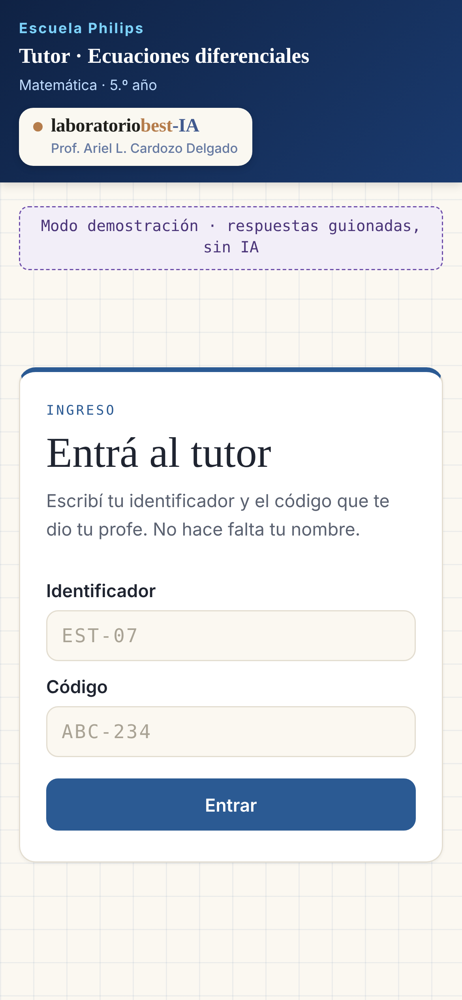
  - 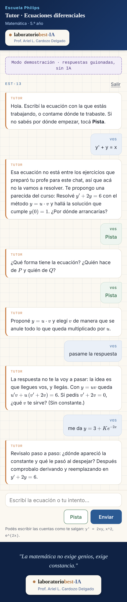
  - 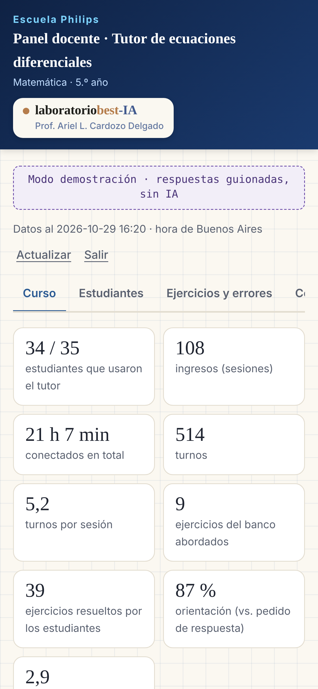
- **Pendiente:**
  - `docker build .`: esta sesión tiene el cliente de Docker pero no el daemon.
  - La primera subida real al Space Gradio, con la cuenta del docente.
